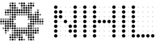

  <picture>
    <source media="(prefers-color-scheme: dark)" srcset="assets/brand/btechos-logo-dark.svg">
    
  </picture>

<b>A multi-host NixOS configuration that runs DarkShadow's Shell.</b>

  <a href="https://github.com/shadowww-dev/DarkShadowShell">DarkShadow's Shell</a> &nbsp;&nbsp;&nbsp;
  <a href="docs/install.md">Install</a> &nbsp;&nbsp;&nbsp;
  <a href="docs/reference.md">Reference</a> &nbsp;&nbsp;&nbsp;
  <a href="docs/inside.md">Inside</a>

BTechOS is a personal NixOS configuration for a laptop and a desktop. It installs and
configures [DarkShadow's Shell](https://github.com/shadowww-dev/DarkShadowShell) — the
Hyprland/niri rice by [shadoww.dev](https://www.tiktok.com/@shadoww.dev) — and keeps the
machine-specific parts of the setup in one flake.

The shell comes from the `darkshadowShell` flake input, currently pinned to **V6.55** in
`flake.lock`. NixOS installs the packages and the SDDM login screen; the shell's own
installer and the patches in this repository manage the user's dotfiles.

## What the shell provides

From DarkShadowShell's own description:

- A **Quickshell settings app** (`SUPER + U`) in the style of Material 3, where the bar,
  wallpaper, appearance, motion, desktop, sound, system and gaming settings are all sliders
  and switches.
- A bar, app launcher, desktop widgets and a dock, with Hyprland or niri as the compositor.
- **Colors from the wallpaper** through matugen. Stylix is intentionally absent: it used to
  rewrite GTK/Qt/terminal colors, which fought the shell's dynamic themes. OpenCode follows
  the system theme too.
- A Material 3 **SDDM** login screen that follows the user's wallpaper and colors.
- The rest of the shell's feature set — layouts, presets, modes, the Update Center and the
  portal integration — comes from upstream; see its
  [README](https://github.com/shadowww-dev/DarkShadowShell#readme) and
  [docs](https://github.com/shadowww-dev/DarkShadowShell/tree/main/docs).

<video width="720" controls src="https://github.com/shadowww-dev/DarkShadowShell/releases/download/v5.06/darkshadow-showcase.mp4"></video>

## What BTechOS adds

- **Multi-host:** `nixosConfigurations.my-laptop` and `nixosConfigurations.my-pc`, each with
  its own `settings.json`, hardware configuration, tracked host configuration and private
  `local.nix`. `my-laptop` is tuned for a Dell Latitude 5480: its `eDP-1` panel runs at
  `1366x768@60` with **0.67 scale**, plus TLP, thermald and btrfs mount options.
- **Patches applied by Nix:** the custom patches that were previously reapplied by hand
  from `~/DarkShadowShell-custom` are vendored in `patches/darkshadow/`. The flake patches
  the shell source at build time and manages the patched scripts, QML, portal files and
  user config through Home Manager.
- **Flatpaks declared in Nix:** the ArtCraft apps that were installed by hand
  (`ai.storyteller.artcraft-launcher` and `ai.storyteller.photocraft`) are installed from
  their remotes on activation. [Gear Lever](https://flathub.org/apps/it.mijorus.gearlever)
  is installed from nixpkgs.
- **Pure evaluation:** wallpapers are read from the flake input, not from an absolute path
  in a home directory, so `nix flake check` works without `--impure`.
- **Installer ISO:** `nix build .#packages.x86_64-linux.iso` produces the installation image.

## Layout

| Path | What it is |
|:---|:---|
| `flake.nix` | Inputs and `nixosConfigurations` (`installer`, `example`, `my-laptop`, `my-pc`) |
| `modules/` | NixOS modules, including `darkshadow.nix`, `darkshadow-patches.nix` and `flatpaks.nix` |
| `hosts/` | Per-machine settings, hardware and configuration; `local.nix` is private and gitignored |
| `patches/darkshadow/` | Vendored shell patches and the custom user config they install |
| `installer/` | ISO and installer scripts |
| `templates/machine/` | The machine template copied by the installer |

## Learn more

- [Install, and keep it current](docs/install.md)
- [Keys, commands and options](docs/reference.md)
- [Inside BTechOS](docs/inside.md)
- [Features](docs/features.md), [Design](docs/design.md), [Devices](docs/devices.md)

## Credits

- [DarkShadow's Shell](https://github.com/shadowww-dev/DarkShadowShell) by shadoww.dev, MIT
  licensed, for the desktop shell, its Material 3 settings app and its dynamic theming.
- [NixOS](https://nixos.org), [Home Manager](https://github.com/nix-community/home-manager),
  [Hyprland](https://hyprland.org), [niri](https://github.com/YaLTeR/niri) and
  [Quickshell](https://quickshell.org).
- [Caelestia](https://github.com/caelestia-dots/shell) and [Nothing](https://nothing.tech)
  for the design ideas the original project started from.
- The NixOS logo, by Simon Frankau, Tim Cuthbertson and Daniel Baker for the NixOS Project
  ([NixOS/branding](https://github.com/NixOS/branding)), is licensed under
  [CC BY 4.0](https://creativecommons.org/licenses/by/4.0/); BTechOS's mark redraws it as dots.
- Fonts: Doto, Space Grotesk and Space Mono (SIL OFL 1.1), JetBrains Mono (SIL OFL 1.1).
  The website ships subsets of the first three, with their licence in `docs/assets/fonts`.

The code and BTechOS's own sounds are MIT licensed (see `LICENSE`); the logos keep the licences
above, and [`sounds/CREDITS.md`](sounds/CREDITS.md) says where each sound comes from.

## Notes

Public repository: contains no secrets or credentials. Machine-local files
(`hosts/*/local.nix`) are gitignored; Wi-Fi keys, passwords and SSH keys stay on each machine.
